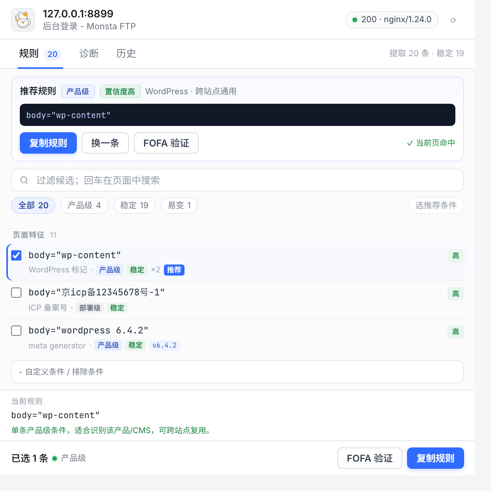

# Lucky Cat

从当前页面提取指纹规则（`body="..."` / `header="..."` / `icon_hash="..."`）的 Chrome 扩展（Manifest V3），产出可直接写进 fingers `finger.yaml` 的 `rule` 表达式。

**扩展本身不内置任何指纹库，也不会把任何指纹数据打包进仓库。** 它只读取当前标签页的页面数据，把可用作指纹的特征列出来供你挑选。



> 产品设计（外观、信息架构、功能优先级）见 [docs/product-design.md](docs/product-design.md)，设计稿见 [design/mockup.html](design/mockup.html)。

## 界面

- **规则**：推荐一条产品级标记 + 候选列表（产品级 / 部署级 / 通用）+ 当前规则与 FOFA 验证
- **诊断**：字段卡片（icon_hash、Server、标题等，保留 FOFA 跳转）、响应头、链接、注释、JS 加载开关
- **历史**：本地保存最近 20 次复制的规则，可复制或在同站点复用

弹窗按 Chrome 上限 600×600 设计，列表内部滚动，主操作固定在底部。

### 字体

界面字体随扩展打包，不依赖系统字体：

- **Inter**（400/500/600）：拉丁字母与数字
- **Noto Sans SC**（可变字重，GB2312 子集，6763 个汉字）：中文
- **JetBrains Mono**（400/500）：规则表达式、哈希、路径等代码内容

字体放在 `assets/fonts/`（OFL 授权，许可证同目录），中文遇到子集外的生僻字会自动回退到系统字体。

## 为什么是「规则提取」

原有版本只展示 `icon_hash`、`server`、`title` 这类固定字段，遇到没有被这些字段覆盖的站点就无能为力。这里换成了「特征 → 条件 → 规则」的流程：

1. 从当前页面采集多来源数据：原始响应、渲染后 DOM、响应头、favicon、页面脚本
2. 自动挑出可能稳定的特征（meta、路径、注释、ICP、版本号、Cookie 名、自定义响应头等），并给出稳定性判断
3. 默认选中一条**产品级**条件并校验；确需收窄范围时再手动组合，界面会提示收窄后果
4. 用「FOFA 验证」确认这条规则的覆盖量，复制表达式即可

## 提取来源

| 来源 | 自动候选 | 说明 |
| --- | --- | --- |
| 基础字段 | 标题、Server、Content-Type、状态码、当前路径 | 来自标签页和响应 |
| 图标 | `icon_hash`（mmh3）、`icon_md5` | 与 FOFA / fingers 的 favicon 取值一致 |
| 响应头 | `Server`、`X-Powered-By`、`X-*` 自定义头、`Set-Cookie` 名 | 跳过 `Date`、`ETag`、`Content-Length` 等易变头 |
| 页面特征 | meta generator、ICP 备案号、版权信息、HTML 注释、资源/API 路径、框架标记、内联 JS 全局变量 | 路径会过滤掉 `static/js/app.js` 这类纯布局路径 |
| 脚本 | 手动开关后加载页面 JS，用于 `js_body` 条件搜索 | 默认关闭，避免拖慢弹窗 |
| 自定义 | 任意 `body`/`header`/`title`/`server`/`path`/`content_type`/`js_body` 条件 | 支持包含、不包含、等于 |

内置关键词搜索：输入 `generator`、`版权所有`、`/api/` 之类的词，会在原始 HTML、响应头、标题、JS 中查找并可以一键加为条件。这是覆盖「自动候选没抓到」的站点时最常用的入口。

## 稳定性判断

每条候选都会标注：

- **稳定**：在原始响应里就存在，不依赖 JS 渲染，重复访问通常不变
- **易变**：包含随机串、时间戳、UUID、长 hex/base64，或只在渲染后的 DOM 里出现（可能是 JS 动态生成）；这类条件会降权并提示
- **未知**：手动添加的条件

排序按置信度从高到低，低分项仍然保留，方便你结合站点实际情况判断。

## 规则范围：产品级 / 部署级 / 通用

| 范围 | 典型来源 | 用途 |
| --- | --- | --- |
| **产品级** | 框架/产品目录、meta generator、产品专属路径 | 识别「这是什么产品/CMS」，跨站点通用 |
| **部署级** | 标题、ICP、Cookie 名、favicon、注释、JS 全局变量 | 只标识当前站点 |
| **通用** | Server、X-Powered-By、Content-Type、状态码 | 覆盖面大但区分度低 |

推荐只从产品级里挑一条。组合条件（尤其 icon_hash + Cookie + 具体路径）通常只对当前部署成立，会把产品指纹「一棒子打死」，所以默认不自动组合。

## 生成规则与 FOFA 验证

点「选推荐条件」只会选中一条产品级条件：

```text
body="wp-content"
```

需要收窄范围时再手动勾选，多条条件会拼成 `&&`，并提示「组合条件会收窄匹配范围」：

```text
body="wp-content" && header="set-cookie: safedog-flow-item="
```

校验与验证：

- 用与 fingers 相同的语法解析，确认表达式合法
- 在当前页执行一次，确认条件成立（`!=` 排除条件在当前页不成立属正常）
- **FOFA 验证**：把当前条件映射成 FOFA 查询并跳转，用来确认覆盖量（支持 `body` / `header` / `title` / `server` / `icon_hash` / `status`；正则等无法映射的条件会被忽略）
- 字段级 FOFA 跳转仍然保留：`icon_hash`、`Server`、页面标题旁的 FOFA 按钮

点「复制表达式」，粘贴到 `finger.yaml` 对应指纹的 `rule` 列表即可：

```yaml
  rule:
    - 'body="wp-content"'
```

扩展不生成、也不读取 finger.yaml，`id`、`name`、`vendor`、`extract` 等条目由你自己维护。

如果某个候选旁边出现 `version=6.4.2`，说明页面里紧邻着版本号，写 `extract` 时可以直接参考这个值。

## 安装

1. 打开 `chrome://extensions`，开启「开发者模式」
2. 「加载已解压的扩展程序」，选择本目录
3. 修改 `manifest.json` / `background.js` 后需要重新加载扩展；已打开的页面刷新一次即可

## 写规则的几个建议

- 识别产品/CMS 时，优先单条产品级标记（`wp-content`、`/nacos/`、meta generator）；组合只用来固定某个具体部署
- 部署级特征适合做「这个站点」的指纹，不适合做产品指纹
- 用 FOFA 验证覆盖量：命中太少说明规则太窄，命中太多（如 `body="admin"`）说明太通用
- 看到「易变」标记要谨慎：`/static/js/app.9f2a1c3b.js` 这类带构建 hash 的路径下次发布就会变
- 生成后建议隔几天再打开同一站点复测一次，确认条件仍然命中

## 代码结构

```text
manifest.json          扩展清单（MV3，service worker + popup）
background.js          响应头采集、跨站资源抓取（绕过页面 CORS）
popup.html/js          弹窗界面、页面数据采集、候选渲染、表达式生成
libs/rule-extractor.js 候选特征提取、稳定性判断、规则表达式生成
libs/rule-dsl.js       规则语法解析、校验与当前页验证
```
无指纹库、无规则数据库文件。

## 测试

```bash
# 规则语法解析 / 校验
node tests/rule-dsl.test.js

# 候选提取、稳定性、表达式生成
node tests/extractor.test.js
```

UI 测试（不需要扩展运行时和网络，用 `tests/harness/stub.js` 模拟 chrome API）：

```bash
# 需要先启动带远程调试端口的 Chrome；脚本会生成 tests/harness.html 并截图
node tests/ui-harness.js 9333
```

端到端（真实 Chrome 加载扩展，针对本地 fixture 页面，需要 Chrome 能访问本地 HTTP）：

```bash
node tests/fixture-server.js 8899
# 另开终端，用 Chrome for Testing（正式版 Chrome 137+ 已移除 --load-extension）：
"$HOME/Library/Caches/ms-playwright/chromium-1228/chrome-mac-arm64/Google Chrome for Testing.app/Contents/MacOS/Google Chrome for Testing" \
  --user-data-dir="$PWD/.chrome-profile" --load-extension="$PWD" \
  --disable-extensions-except="$PWD" --remote-debugging-port=9333 \
  --headless=new --no-sandbox --disable-gpu about:blank

node tests/e2e-popup.js 9333 http://127.0.0.1:8899/page.html
```
