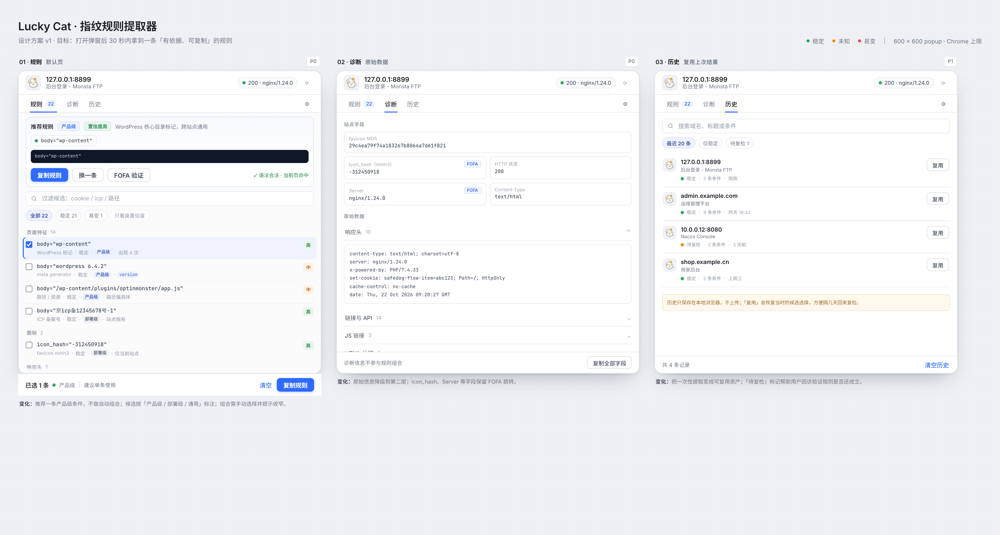

# Lucky Cat · 产品设计 v1

> 视角：产品经理 · 2026-10 · 面向 Chrome 扩展「Lucky Cat」的重设计
>
> 状态：M1 已实现（规则 / 诊断 / 历史 三页、推荐单条、范围标注、FOFA 验证）
>
> 设计稿：[design/mockup.html](../design/mockup.html) · 预览图：[mockup.png](mockup.png)



---

## 0. 一句话定义

**一个装在浏览器里的「指纹规则工作台」：看当前站点 → 拿到 2–3 条有依据、可解释、可直接复制的规则。**

它不识别、不匹配、不内置指纹库。它只做一件事：把「这个站点有什么可当指纹」变成「我该写哪条规则，以及为什么」。

---

## 1. 问题定义

### 1.1 用户真正要做的事

指纹库维护者遇到一个没被覆盖的站点时，任务不是「查看字段」，而是：

0. 这个站点背后是**哪个产品 / CMS / 框架**？我要的是能跨站点复用的指纹，不是只对这个页面成立的规则。
1. 这个页面里有哪些**产品级**或站点独有的特征？
2. 哪个特征**下次访问还在**？
3. 怎么把它写成一条**语法正确、不过度宽泛**的规则？
4. 两分钟后我还能找回这次提取的结果吗？

### 1.2 当前版本的问题

| 问题 | 表现 | 后果 |
| --- | --- | --- |
| 只有字段，没有结论 | icon/server/title 平铺，候选要自己翻 | 用户要自己做一轮「哪些能做指纹」的判断 |
| 信息过载 | 候选、表达式、字段、4 个折叠面板堆在一屏 | 弹窗超过 600px，主操作被推到滚动区 |
| 重复表达 | 候选同时显示原始值和规则片段 | 一屏能看的候选变少 |
| 分数不可解释 | 99 / 96 / 82 这样的数字 | 用户不知道 82 和 86 差在哪 |
| 自动组合 | 「选高置信度」把多条条件直接拼成 `&&` | 规则只对当前页面成立，换个站点/路径就不命中 |
| 没有闭环 | 复制完表达式就结束 | 换个站、隔天再来，全部重做 |
| 诊断信息占主屏 | 响应头/链接/注释与决策同层 | 干扰主任务 |

### 1.3 设计目标

- **快**：打开后 30 秒内能复制一条规则
- **准**：默认推荐的条件是站点独有、且在原始响应中稳定的
- **可解释**：每个推荐都能回答「为什么选它」「为什么说它稳定」
- **可复用**：上次的提取结果能找回来

---

## 2. 用户与场景

### 2.1 用户画像

| 画像 | 占比判断 | 关注点 |
| --- | --- | --- |
| **指纹库维护者**（主要） | 高 | 规则质量、稳定性、可落库 |
| 红队 / 渗透测试 | 中 | 快速判断「这是什么系统」，能带走的特征 |
| 资产测绘 / 运营 | 中 | 规则可复用、可交接、误报低 |

### 2.2 典型场景（JTBD）

- 「扫描器没认出来这个后台，我要在 2 分钟内给它补一条规则。」
- 「这条规则是三个月前写的，我想确认它现在还命中。」
- 「同事要接手这批站点，我得把提取结果给他。」

### 2.3 使用环境约束

- Chrome 扩展 popup，**最大 600×600**，只能内部滚动
- 页面可能有反爬、登录态、动态渲染
- 用户通常一边看页面一边操作，注意力碎片化

---

## 3. 定位与原则

### 3.1 定位

**Rule authoring tool（规则创作工具）**，不是 scanner，也不是指纹库客户端。

### 3.2 非目标

- 不做指纹识别 / 资产搜索
- 不内置、不导入、不修改用户的指纹库
- 不自动提交规则、不替用户做最终判断
- 不做 YAML 导出（按当前需求已移除；复制表达式即交付）

### 3.3 五条设计原则

1. **单条件优先**：默认推荐一条产品级条件；组合会把规则收窄到当前部署，必须由用户显式选择并给出警告。
2. **可解释**：稳定性、推荐度都要能点开看原因。
3. **渐进披露**：诊断数据（响应头/链接/注释）降级到第二层。
4. **单一主按钮**：一屏只有一个「复制规则」是主操作。
5. **少输入多确认**：能用勾选完成，就不要让用户手写。

---

## 4. 核心流程

### Before（当前）

```
打开 → 看到一堆字段 → 自己判断哪些能用
     → 在候选里翻 → 勾选 → 复制
     → 关掉，下次重来
```

### After（设计后）

```
打开 → 站点条确认目标
     → 推荐一条产品级条件（附理由）→ 直接复制
     → 不确定覆盖面：FOFA 验证 / 换一条 / 在候选里微调
     → 关掉；下次从「历史」一键复用
```

关键变化：**默认路径从「浏览 22 条候选、拼一个组合」变成「确认一条产品级规则」；组合只作为显式的收窄手段。**

---

## 5. 信息架构

```
┌ 站点条：favicon · 域名 · 标题 · 状态/Server · 重新提取
├ 分段控件：规则 ｜ 诊断 ｜ 历史
│
├ 规则（默认）
│   ├ 推荐规则：单条产品级条件 · 理由 · 复制/换一条/FOFA 验证 · 校验状态
│   ├ 过滤：搜索 + 全部/稳定/易变 + 只看高置信度
│   ├ 候选：按「图标 / 响应头 / 页面特征 / 自定义」分组
│   └ 底部常驻：已选 N 条 · 稳定性 · 清空 · 复制规则
│
├ 诊断
│   ├ 站点字段：icon_md5 / icon_hash / 状态 / Server / Content-Type
│   ├ 原始数据：响应头 / 链接与 API / JS 链接 / 注释（折叠）
│   ├ JS 开关 + cert/banner 限制说明
│   └ 底部：复制全部字段
│
└ 历史（P1）
    ├ 搜索 + 筛选（最近 / 仅稳定 / 待复检）
    └ 记录：站点 · 条件数 · 时间 · 状态 · 复用
```

每一层只回答一个问题：

- 规则页：**我该选什么？**
- 诊断页：**为什么是这些值？**
- 历史页：**上次怎么做的？**

---

## 6. 外观设计

### 6.1 尺寸与栅格

- popup **600×600**（Chrome 上限），内容区内部滚动，底部动作栏常驻
- 8pt 栅格；水平 padding 14px；候选行高约 44px
- 三栏设计稿仅用于展示三个状态，真实产品一次只显示一个 tab

### 6.2 色彩

| 角色 | 色值 | 用途 |
| --- | --- | --- |
| 背景 | `#eef0f4` / `#fbfbfc` | 页面背景 / 内容区 |
| 表面 | `#ffffff` | 卡片、输入框 |
| 主色 | `#2f6bff` | 主按钮、选中态、分段下划线 |
| 文本 | `#1b1f24` | 主文本 |
| 次要 | `#6b7280` / `#9aa1ab` | 说明 / 占位 |
| 稳定 | `#15803d` + `#e9f5ee` | 稳定标记、校验通过 |
| 未知 | `#b45309` + `#fdf3e4` | 待复检、未知 |
| 易变 | `#b91c1c` + `#fdecec` | 易变警告 |

原则：**语义色只用于稳定性**，不给来源、分数、版本各配一种颜色，避免 badge 彩虹。

### 6.3 字体

- UI：系统字体（PingFang SC / 系统 sans）
- 值与规则：等宽字体（ui-monospace / SF Mono / Menlo）
- 字号：标题 13、正文 11.5、元信息 9.5–10.5、规则 10

### 6.4 组件

站点条、分段控件、推荐卡（浅蓝底 + 深色代码行 + 产品级标记）、条件 chip、候选行（勾选 + 规则片段 + 稳定性 + 范围 + 推荐度）、范围徽标（产品级 / 部署级 / 通用）、FOFA 跳转、底部动作栏、折叠面板、开关、空状态/骨架屏。

### 6.5 动效与反馈

- 交互 120ms ease；tab 切换淡入
- 复制成功：按钮文案变为「已复制」1.2s + 轻提示
- 换一条：推荐卡内容交叉淡入
- 勾选：行背景变浅蓝，左侧 2px 主色条

### 6.6 深色模式（P1）

以 CSS 变量映射，深色下语义色降低饱和度；代码块保持深色底。

### 6.7 可访问性

- 文本对比度 ≥ 4.5:1
- 键盘焦点环 2px 主色
- 稳定性不只靠颜色，附文字（稳定/易变）

---

## 7. 功能设计

### 7.1 优先级总览

| 优先级 | 功能 | 价值 |
| --- | --- | --- |
| **P0** | 推荐单条（产品级优先） | 从「22 选 3、拼组合」变成「确认 1 条可跨站点的规则」 |
| **P0** | 产品级 / 部署级 / 通用标注 | 让用户知道一条规则能覆盖多大范围 |
| **P0** | FOFA 验证与跳转 | 用外部覆盖量验证产品指纹是否成立 |
| **P0** | 候选分组 / 过滤 / 搜索 | 覆盖推荐之外的微调 |
| **P0** | 稳定性解释 | 让「稳定/易变」可信、可判断 |
| **P0** | 表达式实时校验 + 复制 | 交付物 |
| **P0** | 诊断 tab | 保留原有信息，但不干扰主流程 |
| **P0** | 状态设计（加载/空/错误） | 降低困惑 |
| **P1** | 历史与复用 | 把一次性操作变成资产 |
| **P1** | 两次请求对比 | 用真实观测替代启发式 |
| **P1** | 键盘操作 / 深色模式 | 效率与舒适 |
| **P2** | 规则草稿分享 | 团队协作 |
| **P2** | fingers 本地联动 | 打通落库 |

### 7.2 P0 详情

**① 推荐单条（产品级优先）**

- 位置：规则页顶部，默认生成
- 内容：1 条产品级条件 + 理由（如「WordPress 核心目录标记，跨站点通用」）+ 校验状态 +「复制规则 / 换一条 / FOFA 验证」
- **不做自动组合**：把 icon_hash、Cookie、页面路径拼在一起，规则会收窄到当前部署，换站点或换路径就失效；识别产品/CMS 应该用一条跨站点成立的产品级标记
- 「换一条」只在不低于当前等级的产品级候选之间轮换，不生成组合
- 没有产品级标记时不硬推荐，提示用搜索框补充

**② FOFA 验证与跳转**

- 规则级：用当前选中的条件生成 FOFA 查询，一键跳转，确认这个标记的覆盖范围
- 字段级：保留原有的 icon_hash / Server / 标题跳转，放在诊断页对应字段旁
- 无法映射的条件（正则、js_body、content_type、path 等）在按钮上标注「部分条件将被忽略」

**③ 候选列表**

- 只显示**规则片段**（如 `header="set-cookie: safedog-flow-item="`），不再重复原始值
- 次行显示：来源 · 稳定性 · 范围 · 出现次数 · `version=6.4.2`（如可提取）
- **范围徽标**：产品级（可跨站点识别产品）/ 部署级（只描述当前站点）/ 通用（技术栈，区分度低）
- 推荐度用 **高/中/低**，不用 0–100 数字；悬浮解释评分依据
- 推荐行置顶并标「推荐」；点击行切换勾选（不提供展开详情，避免长文本撑坏布局）

**④ 稳定性**

- 三态：稳定 / 未知 / 易变
- 悬浮范围 / 稳定性徽标给出一句话原因：
  - 稳定：「在服务器返回的 HTML 中存在，且不像随机值」
  - 易变：「只在 JS 执行后出现，或包含随机串/时间戳」
  - 未知：「手动添加或来源不足以判断」
- 易变项仍可勾选，但不会成为推荐条件

**⑤ 表达式与校验**

- 勾选实时拼接 `&&` 表达式，按选择顺序
- 只选一条时提示「单条产品级条件，可跨站点复用」；选多条时给出收窄警告
- 用 fingers 同款 DSL 解析校验；在当前页执行验证
- 校验结果三态：语法错误 / 合法且命中 / 合法但当前页未命中（排除条件属正常）

**⑥ 诊断页**

- 站点字段卡片（icon MD5 / icon_hash / 状态 / Server / Content-Type），保留字段级 FOFA 跳转
- 原始数据折叠：响应头、链接与 API、JS 链接、注释
- JS 按需加载开关（用于 js_body 与 JS 全局变量）
- 明确提示：浏览器拿不到 cert / banner

**⑦ 状态**

- 加载：骨架屏（站点条 + 3 条候选占位）
- 空：没有候选 → 引导用搜索框
- 错误：受限页面 / 抓取失败 → 说明原因与重试
- 复制失败 → 降级提示

### 7.3 P1 详情

- **历史**：本地保存最近 20 次提取；记录站点、条件、时间、稳定性；「复用」恢复当时的勾选；超过 7 天标「待复检」
- **两次请求对比**：对当前 URL 连发两次无缓存请求，比较候选值是否一致；一致才标稳定，不一致直接标易变（替代纯正则猜测）
- **键盘**：`/` 聚焦搜索、`↑↓` 移动、`Space` 勾选、`C` 复制、`Esc` 清空
- **深色模式**：跟随系统

### 7.4 P2 详情

- 规则草稿导出/导入（JSON，可选，不涉及规则库）
- 与 fingers CLI 的本地联动（提供「在 CLI 中测试」按钮）
- 相似站点推荐（基于历史）
- 团队评审（评论/标注）

---

## 8. 关键逻辑

### 8.1 推荐单条怎么选

```
1. 候选池 = 稳定 && scope=product
2. 先看 coverage：
   broad    框架/产品标记（wp-content、/nacos/、__next_data__）
   medium   产品路径（/wp-content/plugins/x、/druid/）
   versioned 带版本号的 generator（wordpress 6.4.2）
3. 同层级按推荐度、再按值长度（越短越通用）排序
4. 只取第一条作为推荐；不生成组合
5. 没有产品级候选 → 不硬推荐，提示用搜索框补充
```

「换一条」只在产品级候选池里轮换，且不自动与其他条件组合。

为什么不做自动组合：组合条件（尤其 icon_hash + Cookie + 某条路径）加起来通常只对当前部署成立；用户要的是「某个产品/CMS 的指纹」，组合会把规则一棒子打死。组合仍保留，但必须手动勾选，并明确提示「会收窄匹配范围」。

### 8.2 规则范围（产品级 / 部署级 / 通用）

| 范围 | 含义 | 典型来源 | 适用 |
| --- | --- | --- | --- |
| **产品级** | 跨站点成立的产品/CMS/框架标记 | 框架目录、meta generator、产品专属路径 | 识别「这是什么系统」 |
| **部署级** | 只描述当前部署 | 标题、ICP、Cookie 名、favicon、注释、JS 全局变量 | 标识具体站点 |
| **通用** | 技术栈，覆盖面大但区分度低 | Server、X-Powered-By、Content-Type、状态码 | 辅助判断，不建议单独用 |

界面上用徽标标出；推荐只从产品级里选，部署级/通用项默认折叠在候选里，需要时手动勾选。

### 8.3 推荐度（替代裸分数）

- **高**：产品级 + 稳定 + 非通用；或部署级但站点独有且稳定
- **中**：稳定但偏通用，或产品级里的版本化/长路径
- **低**：通用词、出现次数过多、与站点关联弱

### 8.4 稳定性（当前实现，设计上要解释清楚）

- 形态检查：hex/UUID/时间戳/base64/token 关键词 → 易变
- 来源检查：原始响应中有 → 稳定；只在渲染后 DOM 有 → 易变
- 已知局限：单次采样，不能证明长期稳定 → UI 用「启发式」措辞，P1 用双采样补强

### 8.3 稳定性（当前实现，设计上要解释清楚）

- 形态检查：hex/UUID/时间戳/base64/token 关键词 → 易变
- 来源检查：原始响应中有 → 稳定；只在渲染后 DOM 有 → 易变
- 已知局限：单次采样，不能证明长期稳定 → UI 用「启发式」措辞，P1 用双采样补强

---

## 9. 文案规范

- 用「规则」而不是「表达式」作为用户可见名词（表达示仅作为输入框标签）
- 稳定性用「稳定 / 待确认 / 易变」，避免「dynamic」这类开发词
- 失败文案给出下一步：如「当前页面受浏览器限制，无法读取 DOM，请刷新后重试」
- 不承诺「永久有效」；用「重复访问通常不变」

---

## 10. 指标

### 10.1 北极星

**每周被复制、且 7 天后复检仍能命中的规则数。**

### 10.2 漏斗

| 环节 | 指标 | 目标 |
| --- | --- | --- |
| 打开 | 提取成功率 | > 95% |
| 决策 | 推荐单条复制率 | > 50% |
| 验证 | FOFA 验证点击率 | 20–30% |
| 微调 | 换一条使用率 | 10–20% |
| 交付 | 每次会话复制规则数 | ≥ 1 |
| 复用 | 7 日回访率 | > 25% |

### 10.3 质量

- 推荐单条被取消 / 改选的比例（判断推荐是否可信）
- 手动组合率（过高说明用户还在用「一棒子打死」的思路）
- 平均选择条件数（理想 2–3）
- 易变项被勾选比例（教育是否有效）

---

## 11. 路线图

| 阶段 | 范围 | 预估 |
| --- | --- | --- |
| **M0（本次）** | 设计稿 + 规范 + 评审 | 已完成 |
| **M1** | IA 重构、推荐单条、范围标注、FOFA 验证、候选行、诊断页、状态设计 | 1 周 |
| **M2** | 历史与复用、两次请求对比、深色模式、键盘 | 1 周 |
| **M3** | 草稿分享、fingers 联动、相似站点 | 按需 |

---

## 12. 风险与取舍

| 风险 | 影响 | 应对 |
| --- | --- | --- |
| 推荐单条仍不够通用 | 复制出一条只在小范围命中的规则 | 产品级优先；FOFA 验证覆盖量；可解释；不自动提交 |
| 稳定性是启发式 | 用户误以为已验证 | 文案明确；P1 双采样；历史复检 |
| 600px 高度限制 | 内容放不下 | 三 tab + 内滚动 + 底部常驻动作 |
| 依赖页面可读性 | 受限页面无法提取 | 明确错误态；提示刷新/权限 |
| 不做规则库 | 用户仍需自己落库 | 复制表达式；P2 可选草稿分享 |
| 隐私 | 用户担心页面数据外泄 | 全本地处理、历史可清空、不联网 |

---

## 13. 与当前实现的差距（落地清单）

| 现状 | 目标 | 工作量 |
| --- | --- | --- |
| 单页纵向堆叠 | 三 tab（规则/诊断/历史） | 中 |
| 候选显示原始值 + 规则 | 只显示规则片段 + 元信息 | 小 |
| 无推荐 | 推荐单条 + 换一条 | 中 |
| 「选高置信度」自动组合 | 只选一条产品级条件，组合需手动并警告 | 小 |
| 无范围标注 | 产品级 / 部署级 / 通用 | 小 |
| FOFA 仅字段级 | 增加规则级 FOFA 验证 | 小 |
| 分数 0–100 | 高/中/低 + 解释 | 小 |
| 诊断信息占首屏 | 移入诊断 tab | 小 |
| 无历史 | 本地历史 + 复用 | 中 |
| 无加载/空/错误态 | 统一状态组件 | 小 |
| 无深色/键盘 | P1 | 小 |

数据层需要新增：候选范围标注、推荐单条生成、FOFA 查询映射、历史存储（`chrome.storage.local`）。不新增权限。

---

## 附：设计稿

- 可交互查看：[design/mockup.html](../design/mockup.html)
- 静态预览：[mockup.png](mockup.png)
- 三个状态：规则（默认）、诊断、历史（P1）
